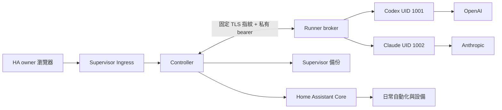

# Agentic Smart Home 實作規格 0.3.1

## 0.3 統一通訊

新增 Web-first onboarding、LINE／Discord／Telegram gateway，以及內外兩層各自登入的 Codex、Claude、Antigravity、Grok Runner。四種 CLI 各自使用 UID 1001–1004。新能力、實際限制與通訊契約見 [GATEWAY.md](docs/GATEWAY.md)。以下家庭操作核心沿用原架構。

## 外層 Linux 優先的部署修正

產品主入口是 Linux ISO／完整安裝 TAR。Controller、Runner 在外層 Linux 的容器運行，HAOS 是 KVM guest；下方原 Ingress 部署只保留為相容模式。完整主機架構、profile、ownership、網路與快照契約見 [LINUX_PRODUCT.md](docs/LINUX_PRODUCT.md)。

host mode 使用獨立主機登入與 HA owner 權杖；登入主機即可在 HAOS 停機時使用 host status、Agent 診斷及 VM 啟停。家庭 mutation 仍需 live HA owner 驗證，不能以主機 session 冒充批准者。Supervisor backup 透過 Core 的 `supervisor/api` WebSocket 代理。host mode 的 `/api/host/` 路由及原有家庭 API 共用 Controller，契約見 `contracts/host-controller.openapi.json`。

Host broker 是 systemd root 服務，只接受固定 VM 的 provision、start、shutdown、snapshot、restore。模型没有任意 shell；外層 Agent 以真實主機觀測提出 typed 建議，UI 顯示具體動作後可交給 broker 執行。

## 權限與部署

Controller 容器啟動後降為 UID 1000，沒有 Agent CLI、Docker socket、主機掛載、shell 執行工具或 HA `.storage` 寫入。Core proxy bearer 只留在 Controller。Supervisor role 為 `backup`。

Runner broker 管理 App 內部憑證；四個 CLI profile 各自 0700，使用不同 UID，任務環境只包含該 provider 必要欄位。App 的 Supervisor token 不會交給 CLI。Runner 沒有 Core API／Supervisor管理權限、HA config 掛載或 Controller UI 授權。

Ingress 管理 API 檢查實際 TCP peer `172.30.32.2`，不信任 forwarded IP。`X-Remote-User-Id` 經 Core `config/auth/list` 查核 active owner；mutation 每次重新查核，搭配 Origin、HMAC CSRF 與已綁定 owner。Runner bearer 不能呼叫這些 API。

## Agent 契約

輸入為明確授權設備的有限 JSON 觀測、使用者需求與 ownership ledger 摘要。輸出為 `contracts/agent-decision.schema.json`：答覆、需要補充、額外 inspect、單次操作意圖或 automation intent。每次只允許一類意圖；20 次額外查詢上限。Controller 重新驗證每個 entity 與 action。

工具語意透過 typed intent 迴圈實現，沒有一般 shell、filesystem、browser 或任意 MCP transport。Codex 固定 CLI + 靜態官方模型 catalog，移除檔案修改及其他工具能力；未知模型名稱會拒絕。Claude 的內建工具清單為空，只保留官方結構化輸出工具。兩者的真實送出工具清單已有本機協定測試。

一次一個 CLI job，最多 10 個排隊。job 最長 300 秒，prompt 32 KiB，回覆 256 KiB，stdout／stderr 各 1 MiB，CLI process group RSS 上限 1 GiB、每 0.5 秒觀測；CPU／經過時間留在 Runner job 紀錄。無自動排程模型呼叫、模型轉送或捏造的美元費用。

## 自動化與操作

Intent 僅支援一個明列 entity 的固定狀態轉換、可選固定時間區間、一至三個 `turn_on`／`turn_off` 動作、`single` 模式。來源不可同時是目標，目標不可重複。不接受任意 YAML、template、service、script、scene、webhook 或間接指令。

Pydantic strict models 禁止額外欄位。確定性編譯器產生原生 `triggers`／`conditions`／`actions` 與 canonical SHA-256。Core 2026.10.1 的原生 `validate_config` 使用複數欄位；寫入 adapter 使用固定版本的 `/config/automation/config/{id}`。

Proposal 綁定確切 ID、原始／草稿／最終設定、完整 digest、policy hash、穩定 inventory metadata、revision、10 分鐘有效期、操作與驗證計畫。只有 UI owner 可產生 approval；每個副作用前再次查身份、授權、相容版本與相關條件。

新建 ID 為 `agentic_<uuidhex>`。修改必須同時有 ledger 且 live config 等於最後已知 hash，僅 ID 前綴不授權。先取得已完成的 HA 備份與 SQLite 一致快照，再建立停用草稿，確認檔案與執行中 raw config，寫最終設定、啟用並讀回。最終啟用設定不含 `initial_state:false`，保留 HA 原生重啟恢復行為。

只有單次 action／設定停用的讀回可直接結案；持續規則要觀測來源轉換、automation context 與 target context 才顯示觸發成功。自動 helper 測試也使用真實 state transitions。未取得新的事件時保持 `verifying`。

## 持久化與恢復

Controller／Runner 各自 SQLite WAL、單 process 寫入。Controller schema version 1，未知 schema 拒絕開啟。每個狀態先持久化；重啟把不確定部署改為 `needs_reconcile`，不重送副作用。

Idempotency key 綁 request digest，重用 key 改內容回 409。Controller writer lock 序列化寫入；沒有宣稱可與 HA 外部編輯器形成跨應用交易。讀回不一致、逾時或回應遺失保留現場，需 reconcile；rollback 亦先比對 live hash。

一般紀錄 30 天、Agent 觀測上下文 7 天，可縮短。當前受管理規則的操作依據與去重 tombstones 保留。Runner 完成 job 保留 7 天，任務工作目錄執行後移除。provider credentials 不進 Controller DB、事件或一般匯出。

Controller 下載備份為 `AGHOME1` 容器格式：PBKDF2-SHA256 390,000 次、隨機 16-byte salt、12-byte nonce、AES-256-GCM，payload 為 SQLite backup API 快照。還原先驗證完整性／schema，再以排他操作建立目標 DB。原生 Runner 備份排除 profiles、work、TLS private；還原後重新配對／授權。

## 原生家庭服務

Alexa 控制 HA、HA 控制 Alexa Devices、Nest 分開提供前提、跳轉、持久化 checkpoint 與回來驗證。家庭 credentials 全由 HA 保管。Alexa 語音實測採 `user_reported_connected`；其他 paths 需 loaded config entry 與 available entities。沒有可用帳號時顯示真實等待／重新授權狀態。

## 介面與可觀測性

繁體中文 React 單頁應用，Ingress 相對資源路徑；桌面 1440、768、390 px 瀏覽器測試。HTTP LAN 不依賴 secure-context-only `crypto.randomUUID`。任務補充、取消、暫停、差異、批准、核對、helpers、自動化管理、服務 checkpoint、備份及保存設定均有 UI。

API 細節由 `contracts/controller.openapi.json` 與 [API_CONTRACT.md](docs/API_CONTRACT.md) 維護。交付真實性依 [VERIFICATION.md](docs/VERIFICATION.md)；硬體與雲端帳號結果不以 fixture 代替。
