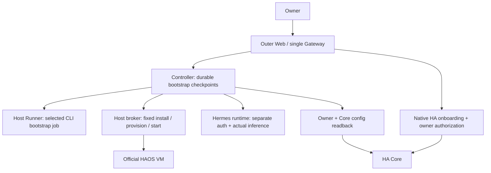

# 2026-10-12：Controller onboarding、Host orchestration 與恢復審查

本次依 Plan v3、Worker Protocol v1 與 2026-10-12 CLI-first onboarding 指示，審查 Controller 的九個設定步驟、Host 固定安裝器、配對恢復、HA owner 綁定與非同步授權邊界。先以產品唯讀方式新增重現測試；整合者授權後修正確認的缺陷。沒有使用真實雲端帳號、使用者家庭、實體 laptop 或開發主機安裝器。

## 結論與修正

初次重現的四項測試全部失敗，原始證據保留於 [review-bootstrap-initial.xml](../../evidence/review-bootstrap-initial.xml)。修正後的 Controller、Host 與 HA OAuth 組合測試為 **63 passed、1 skipped**，見 [review-bootstrap-controller-fixes.xml](../../evidence/review-bootstrap-controller-fixes.xml)。其中 skip 是另行啟用的實際 Core 整合測試，不能算通過。

| 問題 | 原本可重現的結果 | 修正後的行為 |
|---|---|---|
| 暫停與新派工之間的競爭 | `advance()` 等待 Host status 時暫停 AI，回應到達後仍發出新的 HA `provision` | 在查詢返回、CLI 派工、Host 派工及完成 checkpoint 前重新檢查暫停；已送出的工作保留原 handle，不能聲稱已取消 |
| 並行手動 HA 綁定 | 兩個候選身分都在 owner 尚未綁定時通過檢查；候選 session 關閉後，第二個請求可覆蓋第一個 owner/token | 關閉候選 session 後、寫入 token 前同步重查 household；手動 HTTP 路徑另查原登入 session 與 logout epoch，保留 OAuth 原有的 commit guard |
| 原生 HA 完成判定使用過時授權 | `/config` 查詢期間 owner 綁定消失，Controller 仍記錄 onboarding 完成 | 最後讀回後重新比對 owner 與 HA token；身分改變時仍需完成 owner 連結 |
| Runner 配對回應遺失 | 真實 Runner `/pair` 已保存 bearer hash，但 Controller 未收到 bearer；相同重試永久回覆 409 | Runner workline 增加限時、綁定原 code/controller/principal/protocol 的相同回應恢復；不重設配對、不輪替 token。此處的真實 Runner API 重現測試已通過；檔案保留與 restart 測試由 Runtime workline 負責 |
| Hermes 啟動／回讀無期限 | 最新映像已安裝，但執行版本不符、runtime 不可用或模型回覆後仍無驗證時間，流程永久顯示啟動中 | 私有流程記錄保存 120 秒 observation deadline；逾時顯示診斷與明確 retry。Retry 只重新核對原工作，不重裝或重新推理。等待人類登入不設這個期限 |
| 原程序未確認停止 | Runner client 對 `stop_unconfirmed` 繼續輪詢；設定流程可能把它當一般失敗後換新工作 | Runner client 立即回報；Bootstrap 顯示 `runner_needs_reconcile`／`hermes_needs_reconcile`，保留原 job/event，阻止新的推理與 HA 派工 |
| 健康查詢期間登入表單消失 | 每次重新查詢都先清除 `human_action` 並改成 running，CLI／Hermes 登入表單在背景輪詢時消失 | 同一步驟重新觀測不改動 waiting_input／human_action；只有新觀測確認登入或其他狀態改變時才切換。兩個 deterministic barrier 失敗案例保留於 [review-bootstrap-form-before.xml](../../evidence/review-bootstrap-form-before.xml) |

重現程式與後續邊界案例集中於 [test_review_bootstrap.py](../../tests/test_review_bootstrap.py)。測試使用 asyncio barrier 控制競爭時序，不靠碰運氣或反覆跑到綠；deadline 案例使用可控時鐘，涵蓋重啟與同一 retry key 重送。並行 household 案例驗證 Controller 自己的身分不變量，不代表實際 HA 允許同時存在兩名 owner。

## 實際資料與權限路徑



九個步驟依序為 network、runner pairing、CLI auth、CLI assist、Hermes install、Hermes auth、channel、HA provision、HA native。公開 GET 只讀持久化快照；明確 POST start 授權固定工作流程，lifespan task 在頁面關閉或 Controller 重啟後繼續核對。瀏覽器不能提交 completed；模型建議不能選擇 root shell、URL、映像、掛載或 HA 成功狀態。

CLI bootstrap 是受限的設定查證，不是 Plan v3 的 research/development worker。選定 CLI 必須實際完成一次推理，Hermes 必須以自己的帳號完成推理；不複製兩者的 refresh token。LINE、Telegram 等通道另經允許對象與實際 transport 狀態驗證，或由 Owner 明確選 Web 跳過。

發出 Host／Runner 工作前先保存穩定 ID；重新啟動先核對同一工作。已確認失敗與副作用不明是不同狀態：前者需明確 retry，後者保留原 handle 並顯示 needs_reconcile。暫停不會把已送到 Host 的建置或 VM 操作撤回，這些仍須依其原工作結果核對。

## Host 與原生 HA 的證據界線

- `network.ready` 只證明 Host 有 default route；來源欄位為 `outer_host_default_route`，`internet_verified=false`。這不證明 DNS、網際網路或 provider 正常，後面的真實 CLI／Hermes 驗證各自負責那些連線。
- 「latest Hermes」只限尚未使用的新安裝：官方 HEAD 解析成 immutable commit，記錄 archive digest，使用隨產品提供的固定 Dockerfile、adapter 與 locked dependencies，離線 compatibility probe 後才切換；停服後再次檢查沒有新登入。已使用安裝不會被這個流程靜默更新。
- Controller 還會比對 Host 安裝記錄與 runtime 的 upstream commit。映像啟動、帳號 configured、模型文字成功各自都不是 `auth_verified_at` 的替代品。
- 原生 HA `/api/onboarding` 的 typed steps 與 owner/config 分開驗證。Core 重啟後可能沒有 onboarding route；404 本身不代表完成，仍需固定 HA 端點的有效 owner 與實際 config 版本。401／無法連線也不會被當作完成。
- 使用者密碼、家庭位置與帳號同意仍交由 HA 原生流程。Hermes 可取得 allowlisted setup 狀態協助解釋，不能替使用者編造這些設定或自行宣告驗收完成。

## 實際 HAOS 驗證

本次另外執行：

```sh
pytest-disktmp uv run pytest -q tests/test_haos_vm.py --haos-vm --junitxml=evidence/review-haos.xml
```

結果為 **1 passed，84.78 秒**。官方 HAOS 18.3 在獨立 KVM guest 中啟動，實際 Core **2026.10.1**、Supervisor **2026.09.3**；完成 disposable owner 驗證、Supervisor backup 與讀回。證據見 [review-haos.xml](../../evidence/review-haos.xml) 及 [haos-vm.json](../../evidence/haos-vm.json)。使用隨機 loopback port，沒有占用完整 Web E2E 的 8123。

測試專屬 container `agentic-haos-vm-test-1aedb55d6e` 已刪除，磁碟 basetemp 也已清理。這次驗證沒有真實雲端登入、Home Coding Worker、實體設備、laptop 安裝或備份還原；不能延伸成這些項目已通過。

## 對照 Plan v3 的交付範圍

| 階段／要求 | 本次可支持的結論 | 仍需的證據或實作 |
|---|---|---|
| E0 外層工程預覽與恢復 | durable onboarding、固定 Host 診斷、明確 auth 狀態與可重試流程；真實 HAOS owner／backup 已驗證 | Owner 真實 provider／Hermes 登入與實際 laptop 使用；完整 composed Web E2E 由整合者另行紀錄 |
| E1 Hermes＋Host Coding Worker | 目前 Host sandbox 是離線 containment foundation；MCP capabilities 誠實回報 coding worker blocked | 合格的 provider egress／帳號隔離、真正 coding 派工、diff、獨立 tests 與 UI preview；bootstrap CLI 推理不替代這個要求 |
| E2 內外層研究與可回復家庭試跑 | HAOS 是實際 VM；既有家庭控制與 backup 路徑可用 | 真正 HAOS App research/development worker、兩層互補 case 證據、helpers 全流程、候選版本部署與退版；另一個外層 container 不算內層 |
| 固定更新器 | 新安裝 Hermes 有兼容性檢查與 bundled fallback | 本流程不是通用應用 updater，也不是同 schema 更新／退版驗收；仍需批准綁定的 artifact digest、Live 驗證與獨立恢復入口 |

本輪沒有發現應透過放寬 home_operator、共享帳號或讓模型執行 Host shell 才能解決的問題。已修缺陷都是狀態、恢復或授權邊界；E1/E2 缺口仍維持 fail-closed，沒有把平台測試或 fixture 寫成產品能力已完成。
